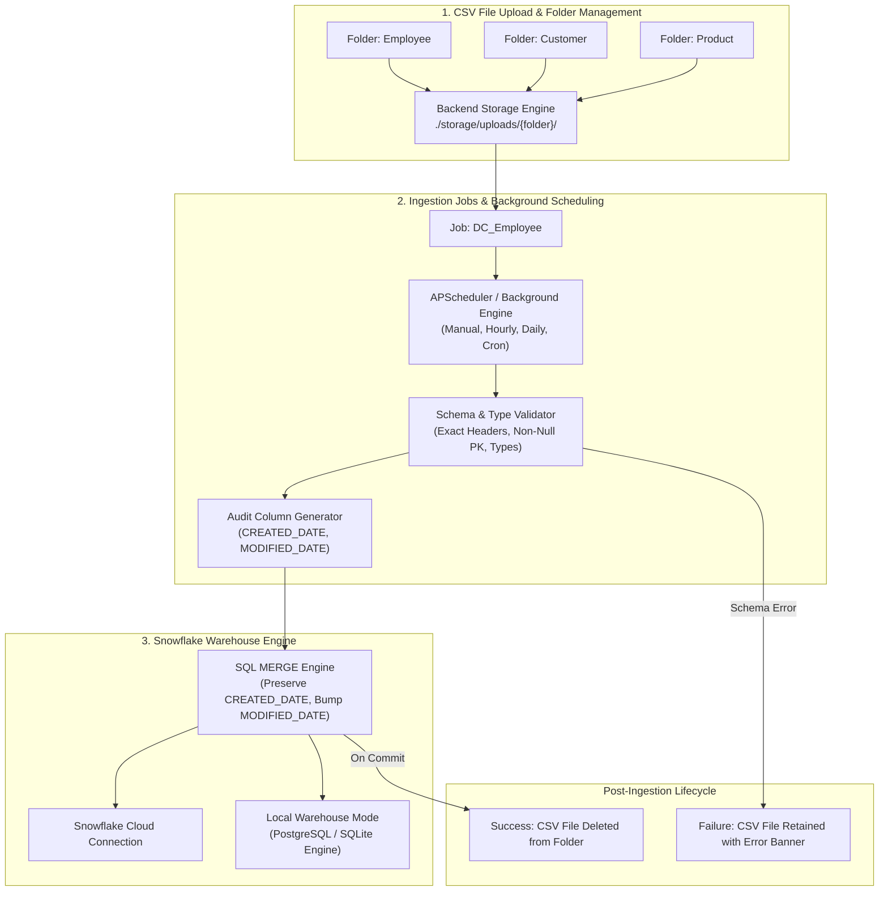

# Enterprise CSV Data Ingestion and Workflow Automation Platform

[](https://pytest.org/)
[](https://vitest.dev/)
[](https://nextjs.org/)
[](https://fastapi.tiangolo.com)
[](https://www.snowflake.com/)

A dynamic, production-grade enterprise data ingestion platform built with **Python**, **SQL**, **Snowflake**, and a modern **Next.js & Tailwind CSS** web application.

The platform provides a streamlined, resilient system where users can upload CSV files into dedicated folders, configure dynamic column schemas and primary keys, execute manual or scheduled ingestion jobs with background scheduler support, and ingest data into Snowflake with automatic audit timestamps (`CREATED_DATE`, `MODIFIED_DATE`) and idempotent MERGE upsert mechanics.

---

## 1. System Architecture & Core Sections



---

## 2. Core Modules

### 1. File Upload & Folder Management
- **Domain-Specific Folders**: Organize inbound files into folders such as `Employee`, `Customer`, and `Product`.
- **Physical Backend Storage**: Uploaded files are written directly to `./storage/uploads/{folder}/` on disk (not browser memory).
- **File Lifecycle Badges**: View uploaded files, sizes, timestamps, and processing statuses (`Waiting Ingestion`, `Processed`, `Failed (Retained)`).
- **Pre-Processing Deletion**: Users can delete uploaded files manually before they are processed.
- **Fault-Tolerant File Retention**: Files that fail schema validation are preserved on disk with explicit error messages for user correction and retry. Successfully processed files are automatically purged after the database transaction commits.

### 2. Job Management & Scheduling
- **Job-to-Folder Association**: Each job links an inbound folder to a target Snowflake table (e.g., `DC_Employee` -> `Employee` folder -> `EMPLOYEE` table).
- **Dynamic Column Configuration**: Users can dynamically add or remove business columns, configure data types (`String`, `Integer`, `Float`, `Date`, `Boolean`), and designate the **Primary Key** (e.g., `Employee_ID`).
- **Exact Schema Enforcement**: The uploaded CSV must contain exactly the configured business columns. Missing columns or unexpected columns trigger explicit schema validation failures.
- **Automatic Audit Columns**: For every job, the platform automatically appends `CREATED_DATE` and `MODIFIED_DATE` to the Snowflake table.
- **Execution Options**: Trigger jobs manually with the **"Run Now"** button or schedule runs via **APScheduler** (`hourly`, `daily`, `cron`).

### 3. Snowflake Data Viewing & Verification
- **Table Browser**: Inspect all configured tables in the data warehouse.
- **Schema Inspector**: View column names, data types, primary key badges, and audit column indicators.
- **Interactive Data Table**: Search records, sort by column, paginate, view total counts, and refresh.
- **Snowflake Cloud & Local Mode Hybrid**: Seamlessly operates in **Local Warehouse Mode** or **Snowflake Cloud Connected Mode**.
- **Credentials Modal**: Configure Snowflake Account, User, Password, Warehouse, Database, and Schema securely without hardcoded credentials.

### 4. Job Execution History & Audit Logs
- Complete execution audit log tracking:
  - Job Name
  - Execution Time
  - Trigger Type (`manual` or `scheduled`)
  - Source File Name
  - Records Processed, Inserted, and Updated
  - Execution Status (`Success` or `Failed`)
  - Detailed error messages for auditability

---

## 3. Working Demonstration Walkthrough: `DC_Employee`

Follow this step-by-step demonstration to verify all core platform workflows:

| Step | Action | Expected Platform Behavior |
| :--- | :--- | :--- |
| **1. Create Folder** | Ensure `Employee` folder exists | Directory `./storage/uploads/Employee/` is verified. |
| **2. Configure Job** | Job `DC_Employee` with columns `Employee_ID` (PK), `Employee_Name`, `Department`, `Email`, `Salary` | Target table `EMPLOYEE` is created with 5 business columns + `CREATED_DATE` and `MODIFIED_DATE`. |
| **3. Upload Initial Batch** | Upload `data/sample_csvs/employee_batch_1.csv` to `Employee` | File appears as `Waiting Ingestion` in the File Upload section. |
| **4. Execute Run** | Click **"Run Now"** on `DC_Employee` | Automatic discovery reads `batch_1.csv`. |
| **5. Validate Schema** | Engine matches headers against configured schema | Validates exact 5 columns and casts data types. |
| **6. Warehouse Ingestion** | MERGE upsert executes | 3 new records inserted; `CREATED_DATE` & `MODIFIED_DATE` set to current timestamp. |
| **7. Verify Database** | Switch to **"Database"** section and select `EMPLOYEE` | 3 employee records displayed with timestamps. |
| **8. File Cleanup** | Inspect `Employee` folder | `batch_1.csv` is removed from disk post-transaction. |
| **9. Upsert Test** | Upload `employee_batch_2_update.csv` (contains existing ID `102` with updated salary + new ID `104`) and click **"Run Now"** | ID `102` updated in-place without duplicate, preserving original `CREATED_DATE` and updating `MODIFIED_DATE`; ID `104` inserted. |
| **10. Invalid CSV Rejection** | Upload `employee_batch_invalid.csv` (missing required `Email` column) and click **"Run Now"** | Job fails with error `Missing required column(s): Email`. File is **retained** in folder for user correction. |

---

## 4. Quick Start & Local Execution

### Prerequisites
- Python 3.9+
- Node.js 18+ and npm

### 1. Backend Setup
```bash
# Create and activate virtual environment
python3 -m venv .venv
source .venv/bin/activate

# Install dependencies
pip install -r backend/requirements.txt

# Run backend test suite
PYTHONPATH=. pytest backend/tests/test_csv_ingestion_platform.py -v

# Launch FastAPI backend
python -m uvicorn backend.app.main:app --host 0.0.0.0 --port 8000
```
Backend health check: `http://localhost:8000/health`  
Interactive Swagger docs: `http://localhost:8000/docs`

### 2. Frontend Setup
```bash
cd frontend

# Install dependencies
npm install

# Run unit tests
npm test

# Build production bundle
npm run build

# Start Next.js web application
npm start
```
Web application: `http://localhost:3000`

---

## 5. Verification Commands

Run backend and frontend tests with:
```bash
# Backend pytest suite (100% passing)
PYTHONPATH=. .venv/bin/pytest backend/tests/test_csv_ingestion_platform.py -v

# Frontend Vitest suite (100% passing)
npm --prefix frontend test
```
